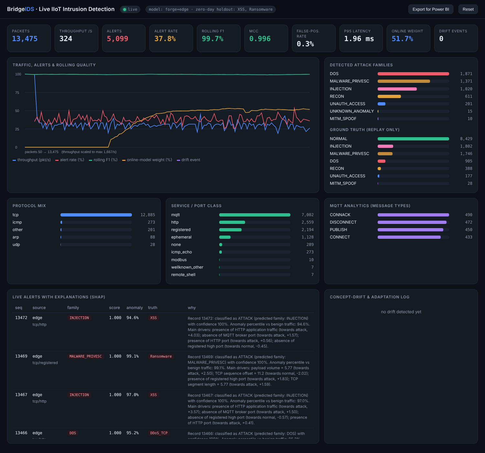
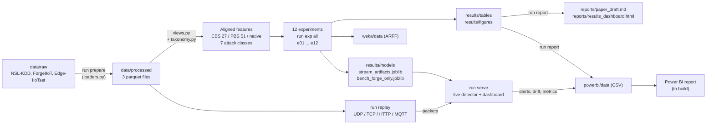

# BridgeIDS — Bridging Legacy IDS and Modern IIoT Security

**Cross-dataset transfer learning · domain adaptation · continual learning · zero-shot detection · NLP "language" representation · explainable AI · drift analysis · live (streaming) detection · Power BI**

```
NSL-KDD (legacy, connection records) ──► ForgeIIoT (bridge, MQTT packets) ──► Edge-IIoTset (modern IIoT packets)
```

> Handwritten project plan this repo implements: [`docs/img/project_plan.jpg`](docs/img/project_plan.jpg)

---

## Contents

1. [Objective](#1-objective)
2. [Status: done / to do](#2-status-done--to-do)
3. [Where is the proof? (plan item → script → output)](#3-where-is-the-proof-plan-item--script--output)
4. [Key results](#4-key-results)
5. [Workflow navigation map](#5-workflow-navigation-map)
6. [Full repository tree (every file explained)](#6-full-repository-tree-every-file-explained)
7. [Outputs in detail (tables, figures, Power BI CSVs)](#7-outputs-in-detail)
8. [Setup and run](#8-setup-and-run)
9. [Data](#9-data)
10. [Known limitations](#10-known-limitations)
11. [Citations](#11-citations)

---

## 1. Objective

Intrusion-detection models trained on old datasets (NSL-KDD) are expected to protect modern Industrial IoT (IIoT) networks. This project tests whether that works and tries to fix it.

- **Main question:** can a model learned on legacy network data detect attacks on modern IIoT data, and what helps it do so?
- **Method:** align three datasets to a shared feature set and attack taxonomy, then test cross-dataset transfer, domain adaptation, continual learning, zero-shot detection, text ("language") representation, explainability and drift.
- **Extension (not in the original plan):** static train-then-test is not how a real network works. Dataset records are also replayed as real network packets (UDP / TCP / HTTP / MQTT) into a live detector that notices drift, adapts from analyst feedback and explains every alert.

Research questions

| ID | Question |
|---|---|
| RQ1 | Do legacy-trained IDS models work on modern IIoT data? |
| RQ2 | Does ForgeIIoT act as a bridge between legacy and modern? |
| RQ3 | Does domain adaptation reduce the gap? |
| RQ4 | Does explainability (SHAP/LIME) reveal the shift? |
| RQ5 | Can attacks never seen in training be detected (zero-shot)? |
| RQ6 (new) | Does dynamic, adaptive detection recover performance after a domain shift? |

---

## 2. Status: done / to do

### Done (all 12 experiments run end to end; tests pass)

| Plan item | Status | Where (click to open in GitHub) |
|---|---|---|
| T1-1 Dataset study | Done | [e01_dataset_study.py](https://github.com/drajdeep/BridgeIDS/blob/main/src/bridgeids/experiments/e01_dataset_study.py) · tables [results/tables](https://github.com/drajdeep/BridgeIDS/tree/main/results/tables) (`e01_*`) |
| T1-2 Feature alignment | Done (3 tiers) | [features/views.py](https://github.com/drajdeep/BridgeIDS/blob/main/src/bridgeids/features/views.py) · [docs/ARCHITECTURE.md](https://github.com/drajdeep/BridgeIDS/blob/main/docs/ARCHITECTURE.md) |
| T1-3 Baselines (DT, RF, AdaBoost, XGB, LGBM, MLP, Weka) | Done | [e02_baselines.py](https://github.com/drajdeep/BridgeIDS/blob/main/src/bridgeids/experiments/e02_baselines.py), [e12_artifacts.py](https://github.com/drajdeep/BridgeIDS/blob/main/src/bridgeids/experiments/e12_artifacts.py) · [models/zoo.py](https://github.com/drajdeep/BridgeIDS/blob/main/src/bridgeids/models/zoo.py) · [weka/](https://github.com/drajdeep/BridgeIDS/tree/main/weka) |
| T1-4 Cross-dataset testing | Done | [e03_cross_dataset.py](https://github.com/drajdeep/BridgeIDS/blob/main/src/bridgeids/experiments/e03_cross_dataset.py) · tables `e03_*` in [results/tables](https://github.com/drajdeep/BridgeIDS/tree/main/results/tables) |
| T1-5 Transfer learning | Done | [e04_transfer.py](https://github.com/drajdeep/BridgeIDS/blob/main/src/bridgeids/experiments/e04_transfer.py) · tables `e04_*` |
| T1-6 Domain adaptation | Done | [e05_domain_adaptation.py](https://github.com/drajdeep/BridgeIDS/blob/main/src/bridgeids/experiments/e05_domain_adaptation.py) · [adaptation/methods.py](https://github.com/drajdeep/BridgeIDS/blob/main/src/bridgeids/adaptation/methods.py) |
| T1-7 Continual learning | Done | [e06_continual.py](https://github.com/drajdeep/BridgeIDS/blob/main/src/bridgeids/experiments/e06_continual.py) · [models/npnet.py](https://github.com/drajdeep/BridgeIDS/blob/main/src/bridgeids/models/npnet.py) (EWC) |
| T2-1 Literature review (44 papers) | Done (links need manual check) | [reports/related_work.md](https://github.com/drajdeep/BridgeIDS/blob/main/reports/related_work.md) |
| T2-2 Attack taxonomy | Done (7 classes) | [data/taxonomy.py](https://github.com/drajdeep/BridgeIDS/blob/main/src/bridgeids/data/taxonomy.py) · [e01_dataset_study.py](https://github.com/drajdeep/BridgeIDS/blob/main/src/bridgeids/experiments/e01_dataset_study.py) |
| T2-3 NLP representation | Done | [e07_nlp.py](https://github.com/drajdeep/BridgeIDS/blob/main/src/bridgeids/experiments/e07_nlp.py) · [nlp/](https://github.com/drajdeep/BridgeIDS/tree/main/src/bridgeids/nlp) |
| T2-4 Zero-shot detection | Done | [e08_zeroshot.py](https://github.com/drajdeep/BridgeIDS/blob/main/src/bridgeids/experiments/e08_zeroshot.py) · [models/hybrid.py](https://github.com/drajdeep/BridgeIDS/blob/main/src/bridgeids/models/hybrid.py) |
| T2-5 XAI (SHAP, LIME, explanation drift) | Done | [e09_xai.py](https://github.com/drajdeep/BridgeIDS/blob/main/src/bridgeids/experiments/e09_xai.py) · [xai/explain.py](https://github.com/drajdeep/BridgeIDS/blob/main/src/bridgeids/xai/explain.py) |
| T2-6 Drift analysis | Done | [e10_drift.py](https://github.com/drajdeep/BridgeIDS/blob/main/src/bridgeids/experiments/e10_drift.py) · [drift.py](https://github.com/drajdeep/BridgeIDS/blob/main/src/bridgeids/drift.py) |
| T2-7 Power BI | **Kit done**, `.pbix` not built (see below) | [powerbi/](https://github.com/drajdeep/BridgeIDS/tree/main/powerbi) · [POWERBI_GUIDE.md](https://github.com/drajdeep/BridgeIDS/blob/main/powerbi/POWERBI_GUIDE.md) · [powerbi/data/](https://github.com/drajdeep/BridgeIDS/tree/main/powerbi/data) |
| RQ1–RQ5 answers | Done | [section 4](#4-key-results) · [reports/paper_draft.md](https://github.com/drajdeep/BridgeIDS/blob/main/reports/paper_draft.md) · [reports/results_dashboard.html](https://github.com/drajdeep/BridgeIDS/blob/main/reports/results_dashboard.html) |
| Live (dynamic) detection, RQ6 | Done | [stream/](https://github.com/drajdeep/BridgeIDS/tree/main/src/bridgeids/stream) · [e11_stream_benchmark.py](https://github.com/drajdeep/BridgeIDS/blob/main/src/bridgeids/experiments/e11_stream_benchmark.py) |
| Leakage audit of the hand-over notebooks | Done | [e02_baselines.py](https://github.com/drajdeep/BridgeIDS/blob/main/src/bridgeids/experiments/e02_baselines.py) · [e02_leakage_audit.md](https://github.com/drajdeep/BridgeIDS/blob/main/results/tables/e02_leakage_audit.md) · [notebooks/handover_original/](https://github.com/drajdeep/BridgeIDS/tree/main/notebooks/handover_original) |
| Setup for Windows and Linux, tests | Done | [SETUP_WINDOWS.md](https://github.com/drajdeep/BridgeIDS/blob/main/docs/SETUP_WINDOWS.md), [SETUP_LINUX.md](https://github.com/drajdeep/BridgeIDS/blob/main/docs/SETUP_LINUX.md), [setup_windows.bat](https://github.com/drajdeep/BridgeIDS/blob/main/setup_windows.bat), [setup_linux.sh](https://github.com/drajdeep/BridgeIDS/blob/main/setup_linux.sh), [tests/](https://github.com/drajdeep/BridgeIDS/tree/main/tests) |

### To do

| Item | Why it is not done | What to do |
|---|---|---|
| **Build the Power BI report (`.pbix`)** | A `.pbix` can only be created inside Power BI Desktop | Follow [`powerbi/POWERBI_GUIDE.md`](powerbi/POWERBI_GUIDE.md): load the CSVs, add `BridgeIDS_measures.dax` and `BridgeIDS_theme.json` (about 20 minutes) |
| Full-scale re-run | Experiments use capped samples for speed | Raise limits in `configs/default.yaml` (`prepare:` and `experiments:`), then `run_all` |
| Sentence-BERT embeddings | The model could not be downloaded when the project was built; an offline TF-IDF+LSA encoder was used | `pip install sentence-transformers`; the code switches to it automatically |
| Verify related-work table | Links and page numbers were checked against public listings only | Confirm venues, pages and DOIs before submission |
| Stabilise DANN | Adversarial adaptation is unstable across seeds | Tune epochs and learning rate (`dann_epochs` in config) |
| Handle ForgeIIoT label noise | Every packet in an attack capture file is labelled as that attack, including background traffic | Relabel with flow-level ground truth if available, or state it in the paper |
| Test on a real network | Streaming was tested by replaying datasets | Point the replayer or a real sensor at the live server |

---

## 3. Where is the proof? (plan item → script → output)

All numbers are generated by the scripts, never typed by hand. To reproduce one item, run `python -m bridgeids.run exp <number>`.

| Plan item / RQ | Script (`src/bridgeids/experiments/`) | Result tables (`results/tables/`) | Figures (`results/figures/`) |
|---|---|---|---|
| T1-1 dataset study, T2-2 taxonomy | `e01_dataset_study.py` | `e01_*` | `e01_superclass_*` |
| T1-3 baselines + leakage audit | `e02_baselines.py` | `e02_*` | `e02_baselines_f1`, `e02_leakage_audit` |
| T1-4 cross-dataset, RQ1, RQ2 | `e03_cross_dataset.py` | `e03_*` | `e03_cbs_*`, `e03_pbs_*` |
| T1-5 transfer learning | `e04_transfer.py` | `e04_*` | `e04_transfer_curves` |
| T1-6 domain adaptation, RQ3 | `e05_domain_adaptation.py` | `e05_*` | `e05_domain_adaptation_auc` |
| T1-7 continual learning | `e06_continual.py` | `e06_*` | `e06_continual_*` |
| T2-3 NLP representation | `e07_nlp.py` | `e07_*` | `e07_text_embedding_map` |
| T2-4 zero-shot, RQ5 | `e08_zeroshot.py` | `e08_*` | `e08_*` |
| T2-5 XAI, RQ4 | `e09_xai.py` | `e09_*` | `e09_*` |
| T2-6 drift | `e10_drift.py` | `e10_*` | `e10_*` |
| Static → dynamic, RQ6 | `e11_stream_benchmark.py` | `e11_*` | `e11_stream_static_vs_dynamic` |
| Weka, Power BI export, live models | `e12_artifacts.py` | `e12_weka_results.*` | — |

Other evidence: `reports/paper_draft.md` (auto-written from the tables), `reports/results_dashboard.html` (all figures and tables in one page), `docs/PLAN_COVERAGE.md` (audit of the hand-over and what changed), `results/logs/` (run time and status of each experiment, created when you run).

---

## 4. Key results

(From `results/tables`, seed 42. Rerunning gives the same numbers.)

| Question | Finding |
|---|---|
| RQ1 legacy → modern | NSL-KDD model on Edge-IIoTset: ROC-AUC **0.583** (near chance). Edge → NSL is inverted (AUC 0.253), a sign of concept drift |
| RQ2 bridge | ForgeIIoT → Edge-IIoTset: AUC **0.853** on shared features; proxy-A-distance 1.44 (Forge–Edge) vs 1.97 (NSL–Edge); concept shift 0.035 vs 0.386 |
| RQ3 domain adaptation | Helps only where concepts are shared (CORAL +0.055 AUC NSL→Forge, DomainNorm +0.037 Forge→Edge). Cannot fix NSL→Edge |
| NLP "language" representation | Forge → NSL AUC 0.340 → **0.787**; NSL → Edge 0.583 → 0.714 |
| Continual learning | EWC + Replay final balanced accuracy **0.857** (naive 0.744), backward transfer +0.148 |
| RQ5 zero-shot | Never-seen Edge injection attacks detected at **98%** using only normal traffic from the target (benign false-alarm rate 10%). Naming the unseen class: 58% vs 25% chance |
| RQ4 XAI | SHAP ranking agreement Forge–Edge ρ = **0.62**, NSL–Forge ρ = −0.03 |
| RQ6 static → dynamic | After a Forge→Edge shift: MCC 0.618 → **0.864**, false-alarm rate 0.58 → 0.22, with 10% analyst feedback. Drift flagged 1128 packets after the switch |
| Leakage audit | ForgeIIoT accuracy 69.4% leak-free vs **99.9%** with `frame.number` / `frame.time_epoch` / `tcp.stream`. The hand-over notebook's "100%" was label leakage |



---

## 5. Workflow navigation map



Reading order for a newcomer

1. This README, then [`docs/PLAN_COVERAGE.md`](docs/PLAN_COVERAGE.md) (what was handed over, what was wrong, what was added).
2. [`docs/ARCHITECTURE.md`](docs/ARCHITECTURE.md) (feature tiers and live-engine decisions).
3. [`reports/results_dashboard.html`](reports/results_dashboard.html) (open in a browser) and [`reports/paper_draft.md`](reports/paper_draft.md).
4. [`notebooks/BridgeIDS_walkthrough.ipynb`](notebooks/BridgeIDS_walkthrough.ipynb) (step-by-step demo of the code).
5. Run `demo_stream` to see the live detector.

Three kinds of feature sets used everywhere

| Name | Size | Used for |
|---|---|---|
| **CBS** (common) | 27 features shared by all three datasets | Cross-dataset testing with NSL-KDD |
| **PBS** (packet) | 51 features shared by ForgeIIoT and Edge | Forge ↔ Edge testing |
| **Native** | Each dataset's own leak-free columns | In-domain baselines |

---

## 6. Full repository tree (every file explained)

```
BridgeIDS/
│
├── README.md                      This file
├── requirements.txt               Python packages (pip install -r)
├── pyproject.toml                 Makes `bridgeids` importable (pip install -e .)
├── .gitignore                     Files git should not store (venv, caches, large raw data, weka.jar)
│
├── setup_windows.bat              Windows: creates .venv, installs packages
├── setup_linux.sh                 Linux/macOS: creates .venv, installs packages
├── run_all.bat / run_all.sh       Runs prepare → 12 experiments → report
├── demo_stream.bat / .sh          Starts the live detector, opens the dashboard, replays packets
│
├── configs/
│   └── default.yaml               All settings: paths, sample sizes, seeds, stream options, zero-shot holdouts
│
├── scripts/
│   └── prepare_data.py            Builds data/processed/*.parquet from the raw data (same as `run prepare`)
│
├── src/bridgeids/                 THE CODE (Python package)
│   ├── run.py                     Command line: prepare | exp | report | serve | replay
│   ├── utils.py                   Config loading, logging, seeding, metrics, file helpers
│   ├── drift.py                   Drift measures: KL, JS, Wasserstein, PSI, MMD, proxy-A, concept shift
│   │
│   ├── data/
│   │   ├── loaders.py             Reads NSL-KDD, ForgeIIoT raw captures and Edge-IIoTset; saves compact parquet
│   │   └── taxonomy.py            The 7 unified attack classes, attack attributes and text descriptions
│   │
│   ├── features/
│   │   └── views.py               Feature alignment: canonical view → CBS / PBS / native leak-free sets
│   │
│   ├── models/
│   │   ├── zoo.py                 Baseline models: DT, RF, AdaBoost, XGBoost, LightGBM, MLP
│   │   ├── npnet.py               Small numpy neural network: MLP, DANN (gradient reversal), EWC (Fisher)
│   │   └── hybrid.py              Zero-day detector: IsolationForest + LightGBM, calibrated on normal traffic
│   │
│   ├── adaptation/
│   │   └── methods.py             DomainNorm, CORAL, TCA, importance weighting, self-training
│   │
│   ├── nlp/
│   │   ├── flow2text.py           Turns a flow/packet into a plain-English sentence (shared "language")
│   │   └── encoders.py            Sentence encoder: SBERT if installed, else offline TF-IDF + LSA
│   │
│   ├── xai/
│   │   └── explain.py             SHAP, LIME, ranking agreement, per-alert plain-English narratives
│   │
│   ├── experiments/               One script per experiment (see section 3)
│   │   ├── common.py              Shared splits and feature-space helpers
│   │   ├── e01_dataset_study.py   Dataset statistics, feature families, attack taxonomy
│   │   ├── e02_baselines.py       In-domain baselines + leakage audit
│   │   ├── e03_cross_dataset.py   Train on A, test on B; domain-shift report
│   │   ├── e04_transfer.py        Fine-tuning with 0.02%–10% target labels
│   │   ├── e05_domain_adaptation.py  Compares the 6 adaptation methods
│   │   ├── e06_continual.py       NSL → Forge → Edge in sequence (naive, EWC, replay, EWC+replay)
│   │   ├── e07_nlp.py             Text representation, in-domain and cross-dataset
│   │   ├── e08_zeroshot.py        Leave-family-out, cross-dataset, DAP and text zero-shot
│   │   ├── e09_xai.py             SHAP/LIME and explanation drift
│   │   ├── e10_drift.py           Feature, concept and attack drift
│   │   ├── e11_stream_benchmark.py  Static vs dynamic detection on a stream (test-then-train)
│   │   └── e12_artifacts.py       Trains live-detector models, runs Weka, exports Power BI data
│   │
│   ├── stream/                    LIVE / DYNAMIC DETECTION
│   │   ├── replayer.py            Sends dataset records as real packets (UDP/TCP/HTTP/MQTT); scenarios: campaign, zero_day, domain_shift, shuffle
│   │   ├── engine.py              The adaptive detector: auto-detects schema, PSI/ADWIN drift, sliding-window challenger model, analyst feedback, SHAP narratives
│   │   ├── server.py              FastAPI server: receives packets, stores alerts in SQLite, WebSocket to dashboard
│   │   ├── artifacts.py           Trains/loads the models the live detector uses
│   │   └── static/dashboard.html  The live web dashboard (http://127.0.0.1:8000)
│   │
│   └── reporting/
│       ├── plots.py               Figure style used by all experiments
│       ├── powerbi.py             Writes the Power BI star-schema CSVs
│       └── report.py              Builds paper_draft.md, results_dashboard.html and the Power BI export
│
├── tests/
│   ├── test_core.py               4 tests: neural-net gradient check, EWC Fisher check, DANN runs, feature views
│   └── test_stream.py             1 test: replay → engine, in-process
│
├── data/
│   ├── raw/
│   │   ├── nsl_kdd/               KDDTrain+ / KDDTest+ (.txt has attack names; .arff has only normal/anomaly)
│   │   ├── forge/                 Put ForgeIIoT here (not in repo, see section 9)
│   │   └── edge_iiot/             Put ML-EdgeIIoT-dataset.csv here (not in repo)
│   └── processed/
│       ├── nsl.parquet            Prepared NSL-KDD sample
│       ├── forge.parquet          Prepared ForgeIIoT sample (10,000 packets per capture + 20,000 normal)
│       └── edge.parquet           Prepared Edge-IIoTset (full 157,800 rows)
│
├── results/                       GENERATED OUTPUTS (see section 7)
│   ├── tables/                    66 files: a .csv and a .md for each result, plus a few .json (e01_* … e12_*)
│   ├── figures/                   26 PNG figures
│   ├── models/                    stream_artifacts.joblib (live detector), bench_forge_only.joblib (domain-shift demo)
│   └── logs/                      run_summary_*.json: status and seconds for each experiment
│
├── reports/
│   ├── paper_draft.md             Paper draft; numbers are pulled from results/tables
│   ├── related_work.md            44 related papers (2023–2026) in 7 groups + gap analysis
│   └── results_dashboard.html     Single-page view of all tables and figures (open in a browser)
│
├── powerbi/                       POWER BI KIT
│   ├── POWERBI_GUIDE.md           Step-by-step build guide: pages, slicers, real-time options
│   ├── BridgeIDS_measures.dax     Ready-made DAX measures
│   ├── BridgeIDS_theme.json       Colour theme for the report
│   ├── load_bridgeids_folder.pq   Power Query script that loads all CSVs at once
│   └── data/                      17 CSVs: 2 dimension tables, 11 fact tables, 4 live-stream tables (section 7)
│
├── weka/
│   ├── README.md                  How to use Weka with these files
│   ├── run_weka.bat / .sh         Command-line runs of J48, RandomForest, AdaBoostM1
│   └── data/                      12 ARFF files: {nsl, forge, edge} × {native, cbs} × {train, test}
│                                  (weka.jar is not included; it is found automatically or passed to the script)
│
├── notebooks/
│   ├── BridgeIDS_walkthrough.ipynb    Step-by-step demo of the whole pipeline
│   └── handover_original/             The three notebooks received, kept unchanged
│       ├── README.md
│       ├── ML_EdgeIIoT_XAI_NIDS_Colab_Fast_Optimized.ipynb                 Edge-IIoTset baseline
│       ├── NSL_KDD_XAI_NIDS_Kernel_Weka_Colab_Stronger_Accuracy.ipynb      NSL-KDD baseline
│       └── Project_Network_Intrusion_Detection_Data.ipynb                  ForgeIIoT (has the leakage problem)
│
└── docs/
    ├── PLAN_COVERAGE.md           Audit: what was handed over, what was wrong, plan → code → evidence, improved plan and schedule
    ├── ARCHITECTURE.md            Feature alignment tiers and live-engine decisions
    ├── SETUP_WINDOWS.md           Windows install, data, run, troubleshooting
    ├── SETUP_LINUX.md             Linux/macOS install, data, run, troubleshooting
    └── img/
        ├── project_plan.jpg       The original handwritten plan
        └── dashboard_live.png     Screenshot of the live dashboard
```

---

## 7. Outputs in detail

### Result tables (`results/tables/`, each as `.csv` + `.md`)

| Prefix | Files | What it shows |
|---|---|---|
| `e01_` | `dataset_statistics`, `label_distribution`, `feature_family_comparison`, `attack_taxonomy`, `attack_relationship_matrix` | Sizes, class counts, which feature families exist in each dataset, how attack names map to the 7 classes |
| `e02_` | `baselines_binary`, `baselines_superclass`, `leakage_audit` | In-domain scores for each model; accuracy with vs without leaking columns |
| `e03_` | `cross_dataset_binary`, `cross_dataset_superclass`, `domain_shift_report` | Train-on-A/test-on-B scores and distance between datasets |
| `e04_` | `transfer_learning_results`, `transfer_raw` | Score vs number of target labels, scratch vs fine-tuned |
| `e05_` | `domain_adaptation` | AUC for every adaptation method and dataset pair |
| `e06_` | `continual_learning`, `continual_learning_with_matrices` | Final accuracy, forgetting and backward transfer per strategy |
| `e07_` | `nlp_in_domain`, `nlp_cross_dataset`, `text_examples.json` | Numeric vs text vs combined features; example sentences |
| `e08_` | `zeroshot_lofo`, `zeroshot_cross_dataset`, `semantic_zsl`, `semantic_zsl_confusion_dap` | Detection of unseen attack families and naming them |
| `e09_` | `shap_cbs_importance_by_dataset`, `shap_top_features_native`, `shap_shift_forge_model_on_edge`, `explanation_drift_rank_agreement`, `lime_explanations_edge`, `xai_summary.json` | Which features matter, per dataset, and how that changes |
| `e10_` | `drift_summary`, `feature_drift` | Distance between datasets overall and per feature |
| `e11_` | `stream_benchmark`, `stream_benchmark_timeline` | Static vs dynamic detector, overall and over time |
| `e12_` | `weka_results` | Weka J48 / RandomForest / AdaBoostM1, in-domain and cross-dataset |

### Figures (`results/figures/`)

| Experiment | Figures |
|---|---|
| E01 | `e01_superclass_distribution`, `e01_superclass_share_heatmap` |
| E02 | `e02_baselines_f1`, `e02_leakage_audit` |
| E03 | `e03_cbs_matrix_f1`, `e03_cbs_matrix_roc_auc`, `e03_pbs_matrix_f1`, `e03_pbs_matrix_roc_auc` |
| E04 | `e04_transfer_curves` |
| E05 | `e05_domain_adaptation_auc` |
| E06 | `e06_continual_matrices`, `e06_continual_summary` |
| E07 | `e07_text_embedding_map` |
| E08 | `e08_cross_dataset_zeroshot`, `e08_lofo_edge`, `e08_lofo_forgeiiot` |
| E09 | `e09_shap_cbs_heatmap`, `e09_shap_native_edge`, `e09_shap_native_forge`, `e09_shap_native_nsl`, `e09_shap_shift` |
| E10 | `e10_drift_bars`, `e10_drift_summary`, `e10_feature_concept_shift`, `e10_feature_js` |
| E11 | `e11_stream_static_vs_dynamic` |

### Power BI data (`powerbi/data/`)

| Type | Files |
|---|---|
| Dimensions | `dim_dataset`, `dim_attack` |
| Facts (from experiments) | `fact_model_performance`, `fact_label_distribution`, `fact_drift_summary`, `fact_drift_feature`, `fact_feature_importance_cbs`, `fact_feature_importance_native`, `fact_continual_learning`, `fact_zeroshot_lofo`, `fact_zeroshot_cross_dataset`, `fact_stream_benchmark`, `fact_stream_benchmark_timeline` |
| Live stream | `stream_events`, `stream_alerts`, `stream_drift`, `stream_metrics` |

Refresh all of them with `python -m bridgeids.run report`.

---

## 8. Setup and run

Python 3.10–3.13, CPU only (no CUDA or PyTorch needed; a small numpy network provides the MLP, DANN and EWC).

| | Windows | Linux / macOS |
|---|---|---|
| 1. install | `setup_windows.bat` | `./setup_linux.sh` |
| 2. run everything | `run_all.bat` | `./run_all.sh` |
| 3. live demo | `demo_stream.bat campaign edge` | `./demo_stream.sh campaign edge` |

Detailed guides: [`docs/SETUP_WINDOWS.md`](docs/SETUP_WINDOWS.md) · [`docs/SETUP_LINUX.md`](docs/SETUP_LINUX.md)

The repo already contains the prepared data (`data/processed`), trained live-detector models (`results/models`) and all results, so you can run `demo_stream` and `report` straight away without the raw ForgeIIoT / Edge data. A full `run_all` took about 23 minutes on a cloud machine; expect similar on a laptop.

Commands (run from the repo root, inside the virtual environment)

```bash
python -m bridgeids.run prepare [--force]        # raw data -> data/processed/*.parquet
python -m bridgeids.run exp all                  # all experiments (or: exp 03 05 08)
python -m bridgeids.run report                   # paper draft, HTML dashboard, Power BI CSVs
python -m bridgeids.run serve [--artifacts bench_forge_only]    # live detector at http://127.0.0.1:8000
python -m bridgeids.run replay --scenario campaign|zero_day|domain_shift|shuffle \
                               --dataset edge|forge|nsl --rate 400 --transport udp|tcp|http|mqtt
python -m pytest -q tests                        # run the tests
```

Live scenarios

| Scenario | What it simulates |
|---|---|
| `campaign` | Normal traffic, then a sequence of attacks |
| `zero_day` | An attack family the detector was not trained on |
| `domain_shift` | Traffic switches from ForgeIIoT to Edge-IIoTset (use with `bench_forge_only` models) |
| `shuffle` | Random mix of records |

---

## 9. Data

| Dataset | In this repo? | Where to get it | Put it in |
|---|---|---|---|
| NSL-KDD | Yes (`data/raw/nsl_kdd`) | Tavallaee et al. 2009 | `data/raw/nsl_kdd` |
| ForgeIIoT (IIEST_IoTForge_Pro) | No (too large). Prepared sample is in `data/processed/forge.parquet` | IEEE DataPort, doi:10.21227/c4z1-yc52 | `data/raw/forge` (folder containing the `Unprocessed Dataset/*.csv` files) |
| Edge-IIoTset (`ML-EdgeIIoT-dataset.csv`) | No (large). Prepared copy is in `data/processed/edge.parquet` | Ferrag et al. 2022 (Kaggle / IEEE DataPort) | `data/raw/edge_iiot` |

Only re-download the raw ForgeIIoT / Edge data if you want to run `prepare --force` or change the sample sizes.

Unified attack classes (from `data/taxonomy.py`): `NORMAL`, `DOS`, `RECON`, `MITM_SPOOF`, `UNAUTH_ACCESS`, `INJECTION`, `MALWARE_PRIVESC`.

---

## 10. Known limitations

- **Capped samples:** experiments use stratified samples for speed (see `configs/default.yaml`). Absolute numbers will change slightly at full scale; the trends should not.
- **ForgeIIoT labels are per capture file**, so some "attack" packets are really background traffic. This limits any model's score on ForgeIIoT and should be stated in any paper.
- **Text features** use an offline TF-IDF + LSA encoder unless `sentence-transformers` is installed.
- **DANN** (adversarial adaptation) is unstable; the other adaptation methods are more reliable.
- **The live demo replays datasets**; it has not been validated on a real network.
- **Power BI `.pbix`** is not included; only the kit to build it.
- **Related-work links** should be verified manually before publication.

---

## 11. Citations

- **NSL-KDD** — M. Tavallaee, E. Bagheri, W. Lu, A. Ghorbani, "A detailed analysis of the KDD CUP 99 data set", IEEE CISDA 2009.
- **ForgeIIoT / IIEST_IoTForge_Pro** — P. Kumar, S. Mullick, R. Das, IEEE DataPort, doi:10.21227/c4z1-yc52.
- **Edge-IIoTset** — M. A. Ferrag et al., IEEE Access 10:40281–40306, 2022, doi:10.1109/ACCESS.2022.3165809.
