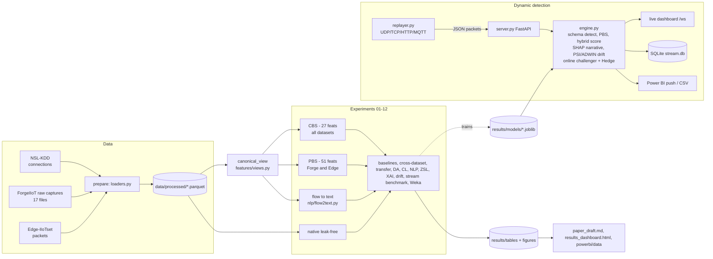

# Architecture

## Feature alignment tiers

| Tier | Shared by | Content | Why |
|---|---|---|---|
| **CBS** Canonical Behavioural Space | NSL-KDD, ForgeIIoT, Edge-IIoTset | protocol one-hot (4); service class (12: http, mqtt, dns, ftp, smtp, remote_shell, modbus, icmp_echo, well-known/registered/ephemeral/none); TCP flag semantics (SYN, ACK, FIN, RST, PSH, half-open); log payload bytes; has-payload; land; app-HTTP; app-MQTT | NSL connection flags (SF, S0, REJ, RSTO…) and services (70 names) map to the same semantics as packet flags and ports |
| **PBS** Packet Bridge Space | ForgeIIoT, Edge-IIoTset | CBS + TCP len/seq/ack (log), SYN-ACK, direction, ARP request/reply, HTTP GET/POST/other/response/content length, MQTT len/topic length/multi-message, MQTT message types (9) | both are tshark exports with the same field semantics |
| **native** | per dataset | NSL 41 features; Forge/Edge numeric tshark fields minus identifiers + PBS | in-domain upper bound |

Never used as features: IP/MAC addresses, checksums, raw ports, `tcp.stream`, `udp.stream`, `frame.number`, timestamps, payload hex.

## Dynamic engine decisions

* **Hybrid score** = max(P_supervised, gated benign-ECDF anomaly percentile); anomaly percentile ≥ 0.999 always alerts (zero-day guard).
* **Online challenger** = LightGBM retrained every 200 analyst labels on the last ≤ 4 000 labels + 2 000 replayed training rows (weight 0.3). Combined with the static model through Hedge weights on prequential log-loss.
* **Drift** = PSI of the last 1 000 packets vs the training reference (checked every 500 packets, alarm on a jump of the top-10 mean PSI > 0.2) + ADWIN on the feedback error stream. On drift: reset the feedback window, re-calibrate the benign anomaly reference with confirmed-benign traffic.
* **Explanations** = SHAP TreeExplainer for the newest ≤ 8 alerts per micro-batch, rendered as natural-language narratives; the other alerts get a component-level explanation.
